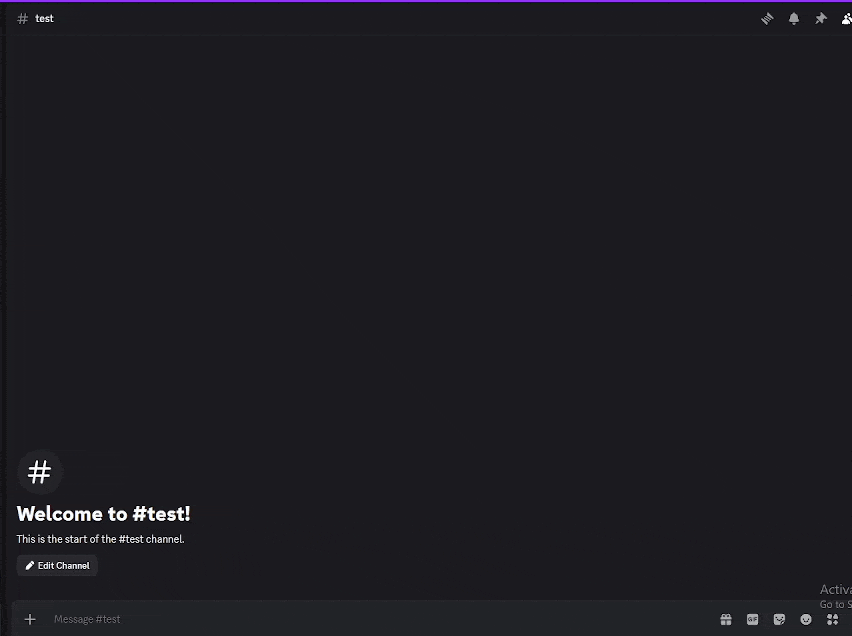

# CardBot

A Discord bot where server members roll random collectible cards, race to claim
them, and compete on a points leaderboard. Community-submitted cards go through
an admin approval workflow.



## Features
- `!roll` for weighted-rarity card drops with a 60-second claim window
- One-click claiming with per-user cooldowns and hourly roll limits
- Community card submissions with Approve/Reject buttons for the server admin
- Collections and a points leaderboard per server
- Admin tools for removing cards, resetting timers, and clearing claims (with confirmation)

## Tech stack
Python 3.10+, discord.py (slash-free prefix commands + UI components), SQLite

## How it works

**Rarity rolls.** A rarity is chosen by weight (common 60 / uncommon 25 / rare 10 /
epic 4 / legendary 1), then a random card is picked within it. Odds stay stable
no matter how many cards exist per tier.

**Race-safe claims.** `claims` has a composite primary key on `(guild_id, card_id)`.
If two users click Claim at the same instant, the database rejects the second
insert rather than relying on application-level locking.

**Restart-proof buttons.** Approval buttons use discord.py's `DynamicItem`, which
encodes state in the `custom_id`. Pending submissions can still be approved after
the bot restarts.

**Persistence tradeoffs.** Claim cooldowns live in SQLite and survive restarts.
Roll counts are in-memory for simplicity and reset on restart. Moving them to
the database is on the roadmap.

## Getting started
1. Clone the repo and install dependencies:
```bash
   pip install -r requirements.txt
```
2. Create a bot in the [Discord Developer Portal](https://discord.com/developers/applications)
   and enable **Message Content Intent**.
3. Copy `.env.example` to `.env` and fill in:
```
   DISCORD_TOKEN=...
   APPROVER_ID=...
   APPROVER_USERNAME=...   # fallback if APPROVER_ID is unset
```
4. Run it:
```bash
   python card_bot.py
```

## Commands
| Command | Description |
|---|---|
| `!roll` / `!r` | Roll a card |
| `!addcard "Name" <rarity> <points>` | Submit a card (attach an image) |
| `!collection [@user]` / `!mm` | View a collection |
| `!leaderboard` / `!lb` | Top collectors |
| `!pending` | Cards awaiting approval |
| `!removecard`, `!reset`, `!clearclaims` | Admin only |

## Testing
```bash
pytest
```

## Limitations and roadmap
- Roll limits reset on restart (move to SQLite)
- Single-process SQLite connection, so not built for multi-shard scale
- Migrate prefix commands to slash commands
- Dockerfile for one-command deployment

## Disclaimer
Inspired by Mudae. Not affiliated with it. Card images are user-submitted.
